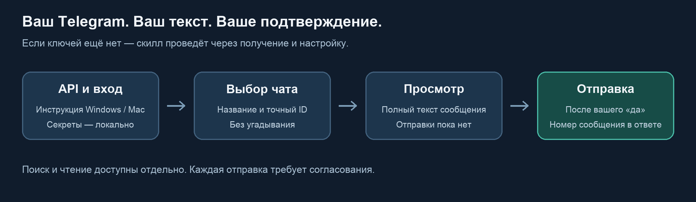

# Telegram

**Найдите чат, прочитайте переписку, отправьте готовый текст — от своего аккаунта,
с показом адресата и сообщения перед отправкой.** Скилл для Claude Code и Codex.

> «Отправь в Избранное: Встреча завтра в 11:00».
>
> Скилл находит ваш аккаунт, показывает текст и адресата. После подтверждения отправляет
> сообщение и возвращает его номер. Если чатов с похожим названием несколько — уточняет.



## Зачем скилл, если можно просто попросить модель

| Обычная просьба модели | Что даёт Telegram |
|---|---|
| Без подключения модель может только написать текст | Скрипты находят реальные чаты, читают и отправляют сообщения через Telethon |
| Непонятно, какой чат будет выбран | Точный адресат с ID в карточке перед отправкой |
| Настройка начинается с «нужны ключи» | Мастер объясняет получение ключей и предлагает шаги при ERROR для Windows/Mac |
| Отправка и черновик легко перепутываются | По умолчанию `tg_send.py` ничего не отправляет: нужен `--yes` после согласования |

## Что умеет

- Искать чат по части названия.
- Читать последние сообщения выбранного чата.
- Отправлять готовый текст, ссылку или Markdown из файла после согласования.
- Настраивать доступ с нуля: API-ключи → локальный вход → проверка подключения.

Это клиент **личного аккаунта**, не Bot API. Токен BotFather не заменяет `api_id` и `api_hash`.

## Установка

Нужны Git и Python 3.9+. Для первого входа — доступ к своему Telegram.

### macOS / Linux

Для Claude Code:

```bash
git clone https://github.com/TimurUgulava/telegram.git ~/.claude/skills/telegram
cd ~/.claude/skills/telegram
python3 -m venv .venv
source .venv/bin/activate
python -m pip install -r requirements.txt
python scripts/setup_telegram.py setup
```

Для Codex используйте `~/.codex/skills/telegram` вместо `~/.claude/skills/telegram`.
Не клонируйте поверх уже установленного скилла; сначала сохраните свои изменения.

### Windows — PowerShell

Для Claude Code:

```powershell
git clone https://github.com/TimurUgulava/telegram.git "$HOME/.claude/skills/telegram"
Set-Location "$HOME/.claude/skills/telegram"
py -m venv .venv
.\.venv\Scripts\python.exe -m pip install -r requirements.txt
.\.venv\Scripts\python.exe scripts/setup_telegram.py setup
```

Для Codex замените `.claude` на `.codex`. Активировать venv в PowerShell не обязательно:
прямой путь к Python работает без изменения ExecutionPolicy.

После установки откройте новую сессию ассистента и скажите: «Используй скилл telegram».
Команды скриптов запускайте Python из созданного venv.

## Если у вас пока нет API-ключей

Скажите ассистенту: **«Настрой Telegram. API-ключей у меня ещё нет»**.
Он проведёт по [инструкции получения ключей](references/api-keys.md).
Если при создании приложения возникает ERROR — объяснит способ с `hosts` отдельно
для Windows или Mac, без обещания универсального решения.

Мастер также покажет инструкцию сам. Ключи, код входа и пароль вводите **только в своём
терминале**, а не в переписке с моделью. Для просмотра инструкции без авторизации:

```text
python scripts/setup_telegram.py api-guide
```

При согласии на локальное сохранение ключи окажутся в `~/.tg/config.json`, сессия —
в `~/.tg/tg_session.session`. Это секретные файлы, не зашифрованное хранилище.
Есть поддержка переменных окружения и существующих ключей macOS Keychain —
[подробнее о настройке](references/setup.md).

## Один пример: текст в Избранное

Попросите: **«Отправь в Избранное: Встреча завтра в 11:00»**.
Скилл сначала делает сухой прогон:

```text
python scripts/tg_send.py --chat me --text "Встреча завтра в 11:00"
```

Вы увидите точный текст и свой аккаунт в качестве адресата. Сообщение пока не отправлено.
После подтверждения скилл выполняет тот же вызов с `--yes` и сообщает `message_id`.
Имя, ID аккаунта и номер отправленного сообщения будут вашими, заранее они не заданы.

Другие задачи:

```text
Найди чат «Команда проекта».
Прочитай последние 10 сообщений из выбранного чата.
Отправь согласованный текст из файла message.md в этот чат.
```

## Команды

Из папки установленного скилла, через его Python:

| Команда | Действие |
|---|---|
| `python scripts/setup_telegram.py setup` | локальный мастер первого входа |
| `python scripts/setup_telegram.py api-guide` | инструкция получения ключей, включая ERROR |
| `python scripts/setup_telegram.py check` | проверка существующего доступа без сообщений |
| `python scripts/tg_resolve.py "Команда"` | поиск чатов по названию |
| `python scripts/tg_read.py me --limit 10` | последние 10 сообщений Избранного |
| `python scripts/tg_send.py --chat me --file message.md` | предварительный просмотр |
| тот же вызов с `--yes` | реальная отправка после согласования |

## Границы и проверка

- Работает от вашего аккаунта: сообщения видны получателям как ваши. Скилл требует
  согласования, но `--yes` — технический переключатель, а не проверка человеческого согласия.
- Не пишет посты, не делает рассылки, не поддерживает переписку автоматически.
- Не редактирует и не удаляет сообщения; не скачивает вложения.
- Не создаёт Telegram API-приложение за вас и не меняет системный hosts автоматически.
- Утверждение «страна номера обязательно должна совпадать со страной IP» не подтверждено.
  Метод hosts помогает при части проблем подключения; от всех причин ERROR он не спасает.
- Автотесты проверяют локальные сценарии, ошибки настройки и отсутствие отправки при
  сухом прогоне. Тесты не входят в настоящий аккаунт и не отправляют сообщения людям.
- Редактирование hosts проверено на временном файле macOS. Новая авторизация и получение
  API-ключей по этому обходу на чистом аккаунте не проверялись; UI Windows вручную не проверялся.
- Сессия должна использоваться последовательно: при занятом SQLite-файле завершите другой
  процесс. Мастер не копирует рабочие сессии ради обхода блокировки.

[Полные правила отправки](references/safety.md) ·
[Инструкция API](references/api-keys.md) · [История версий](CHANGELOG.md)

## Автор

[Тимур Угулава](https://t.me/+ZPqkVNfhlA1mNWIy) — про AI-ассистентов, скиллы
и то, как это всё приделать к живой работе.

## Лицензия

[MIT](LICENSE) — делайте что хотите, ссылка приветствуется.
